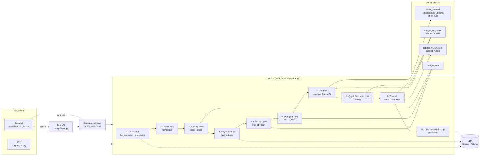
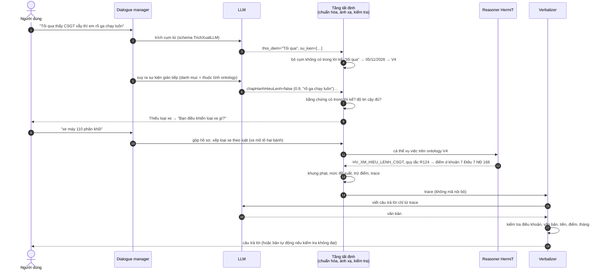
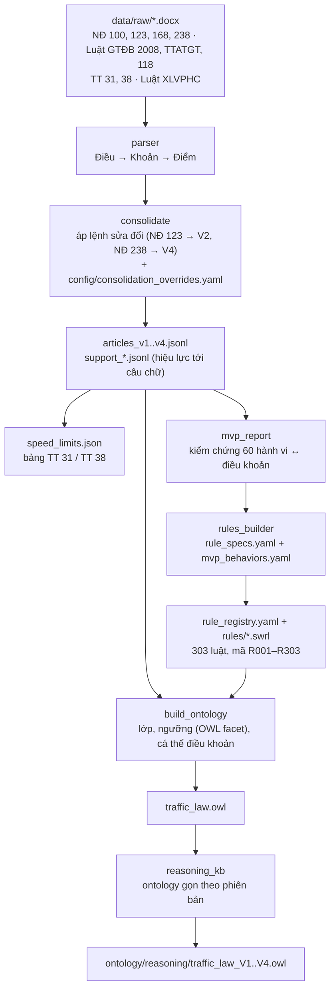
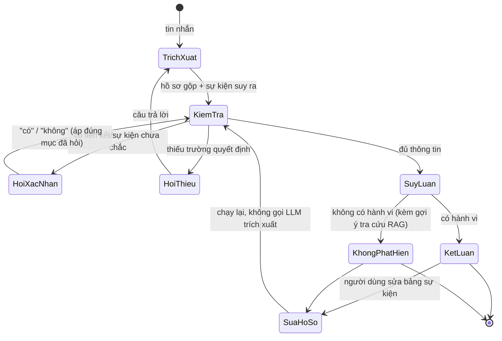

# Kiến trúc hệ thống

Hệ chuyên gia tư vấn vi phạm luật giao thông đường bộ: nhận lời kể tiếng Việt, xác định hành vi vi phạm, điều khoản,
khung phạt, mức đề xuất và giải thích chuỗi suy luận. Tài liệu này mô tả các thành phần, luồng xử lý và lý do thiết kế.
Chi tiết ontology: [ontology_design.md](ontology_design.md). Chi tiết luật: [rules_design.md](rules_design.md).
Kết quả đánh giá: [../evaluation/results/results.md](../evaluation/results/results.md).

## 1. Nguyên tắc chi phối thiết kế

| Nguyên tắc | Hiện thực |
|---|---|
| LLM không quyết định điều khoản hay mức phạt | LLM chỉ ở 3 chỗ: trích cụm từ, suy ra sự kiện gián tiếp, diễn đạt câu trả lời. Kết luận do HermiT chạy trên ontology OWL + luật SWRL |
| Mọi luật truy được về văn bản gốc | 303 luật SWRL sinh từ cấu hình; mỗi luật có mã `R0xx` trong `ontology/rule_registry.yaml` kèm điều/khoản/điểm, nguyên văn, hiệu lực |
| Không lấy nội dung pháp luật từ trí nhớ | Mọi điều khoản, mức phạt, ngưỡng được trích từ `data/raw/` và kiểm chứng bằng cụm từ nguyên văn (test tự động) |
| Áp luật theo thời điểm vi phạm | 4 phiên bản pháp lý V1–V4; văn bản bổ trợ (luật, thông tư) cũng chọn theo ngày |
| Thiếu thông tin thì hỏi lại | `slot_checker` chỉ hỏi trường làm đổi kết luận; sự kiện suy ra chưa chắc thì hỏi xác nhận |

## 2. Các thành phần

Đường liền là luồng dữ liệu; đường đứt nét là lời gọi LLM (chỉ ở bước 1, 4, 10) và chế độ giao diện chạy trực tiếp
không qua API.

## 3. Luồng xử lý một tin nhắn

## 4. Ranh giới LLM và tầng tất định

| Bước | LLM làm gì | Kiểm soát tất định ngay sau đó |
|---|---|---|
| Trích xuất | Chép cụm từ bề mặt vào schema (không chuẩn hóa, không kết luận) | `grounding`: bỏ cụm không có trong lời người dùng; `normalizer`: số, đơn vị, ngày; `entity_linker`: từ điển đồng nghĩa trước, embedding sau (ngưỡng 0,80, liên kết bằng embedding phải được xác nhận) |
| Suy ra sự kiện | Nêu sự kiện hàm ý + độ tin cậy + câu trích | Chỉ thuộc tính có trong ontology (enum); bằng chứng phải có trong lời kể; sự kiện người dùng nói thẳng luôn thắng; tin cậy 0,5–0,8 hoặc "tái phạm" → hỏi xác nhận; căn cứ định nghĩa (vd. "người điều khiển giao thông") đính kèm prompt nguyên văn theo ngày |
| Diễn đạt | Viết câu trả lời từ trace | `kiem_tra`: mọi tham chiếu điều khoản, văn bản, số tiền, số điểm, số tháng phải có trong trace; không mã nội bộ; đủ hành vi; sai → viết lại 1 lần → vẫn sai thì dùng bản tự động |

Mọi bước LLM đều có dự phòng: LLM lỗi ở bước suy ra sự kiện thì vẫn kết luận từ sự kiện trực tiếp; LLM lỗi ở bước
diễn đạt thì dùng bản trình bày tự động (`src/inference/report.py`).

## 5. Xây dựng cơ sở tri thức

Toàn bộ chuỗi chạy lại bằng `python -m scripts.build_all`. Không sửa tay các file sinh ra (`.owl`, `.swrl`,
`rule_registry.yaml`); muốn đổi luật thì sửa cấu hình rồi sinh lại.

**Ngưỡng số không dùng SWRL built-in.** HermiT không hỗ trợ built-in, nên mỗi ngưỡng (nồng độ cồn, mức vượt tốc độ,
dung tích, độ tuổi) là một lớp định nghĩa OWL bằng ràng buộc kiểu dữ liệu, kèm câu văn bản làm căn cứ. Luật SWRL chỉ
nối các lớp. Ví dụ R032: `NhomXeMoTo(?x) ∧ NongDoConMuc2(?h) → HV_XM_CON_2(?h) ∧ QT_R032(?h) ∧ apDungDieuKhoan(…)`.

**Truy vết.** Mỗi luật gán thêm lớp đánh dấu `QT_<mã>` (tương đương `duocSuyRaBoi`) cho cá thể được kết luận.
Tracer đọc lớp này rồi đi ngược thân luật trong sổ đăng ký tới sự kiện đầu vào. Cách này tránh bật suy luận mọi giá
trị thuộc tính, vốn tốn O(n²).

## 6. Mô hình thời gian

| Phiên bản | Áp dụng cho vi phạm | Văn bản xử phạt | Văn bản bổ trợ được chọn theo ngày |
|---|---|---|---|
| V1 | 01/01/2020 – 31/12/2021 | NĐ 100/2019 | Luật GTĐB 2008, TT 31/2019 |
| V2 | 01/01/2022 – 31/12/2024 | NĐ 100 + NĐ 123/2021 | Luật GTĐB 2008, TT 31/2019 |
| V3 | 01/01/2025 – 14/08/2026 | NĐ 168/2024 | Luật TTATGT (theo các mốc sửa đổi của Luật 118/2025), TT 38/2024 |
| V4 | từ 15/08/2026 | NĐ 168 + NĐ 238/2026 | như V3 |

Luật XLVPHC (bản hợp nhất) dùng cho tình tiết và cách chọn mức phạt; hiệu lực tính tới từng câu chữ theo chú thích
của văn bản hợp nhất. Không rõ ngày vi phạm: dùng phiên bản đang có hiệu lực hôm nay và ghi rõ giả định trong câu trả
lời. Khoảng ngày vắt qua hai phiên bản: hỏi ngày chính xác. Thêm phiên bản mới chỉ cần thêm file và khai báo trong
`config/legal_sources.yaml`, không sửa code.

## 7. Hội thoại nhiều lượt

Hồ sơ vụ việc (`HoSoVuViec`, Pydantic) tích lũy qua các lượt; mỗi giá trị ghi nguồn (người dùng nêu, suy ra từ lời
kể, người dùng xác nhận, người dùng sửa, tra bảng, xếp loại theo luật). Câu hỏi xác nhận luôn hỏi riêng một lượt và
mang danh sách mục được hỏi, để "có/không" không bị áp nhầm.

## 8. Bản đồ mã nguồn

| Thư mục | Nội dung |
|---|---|
| `src/ingest/` | `parser` (docx → Điều/Khoản/Điểm), `consolidate` (áp lệnh sửa đổi), `build_articles`, `mvp_report`, `speed_limits` |
| `src/kb/` | `build_ontology`, `rules_builder`, `reasoning_kb`, `reasoner` (HermiT, chia lô), `abox` (cá thể vụ việc), `temporal` (phiên bản, hiệu lực), `penalty` (khung, mức đề xuất, chế tài, trừ điểm), `sanctions`, `toc_do` |
| `src/llm/` | `client` (Gemini/Ollama, cache, retry 429, giới hạn RPM, structured output), `prompts/*_v1.md` (prompt có phiên bản) |
| `src/extraction/` | `schema`, `llm_extractor`, `grounding`, `normalizer`, `entity_linker`, `slot_checker` |
| `src/inference/` | `fact_inducer`, `fact_builder`, `pipeline`, `report` (bản trình bày tự động) |
| `src/explanation/` | `tracer`, `retriever` (nguyên văn theo id + FAISS/bge-m3 cho gợi ý), `verbalizer` (+ kiểm tra chống bịa) |
| `src/dialogue/` | `manager` (phiên, sửa hồ sơ, ngày vi phạm), `serialize` (JSON cho API/giao diện) |
| `src/api/`, `app/` | FastAPI, Streamlit |
| `evaluation/` | `sinh_nhan`, `run_eval`, `baseline_llm_only`, `ablation`, `metrics`, `bao_cao`, `calib_entity_link` |
| `config/` | `legal_sources` (văn bản, phiên bản, hiệu lực), `mvp_behaviors` (hành vi ↔ điều khoản), `rule_specs` (điều kiện luật), `ontology_concepts` (ngưỡng, dấu hiệu, tình tiết), `penalty_decision`, `slots` (câu hỏi), `fact_inducer`, `phan_loai_xe`, `speed_limits`, `consolidation_overrides` |

## 9. Lựa chọn kỹ thuật đáng chú ý

- **HermiT thay Pellet.** Đặc tả chọn Pellet; thử nghiệm cho thấy Pellet 2.3.1 đi kèm owlready2 bỏ sót kết luận của
  luật có lớp ngưỡng khi nạp đủ bộ luật (`tests/test_rules.py::test_pellet_limitation`). HermiT cho kết quả đúng.
  Đổi bằng `REASONER` trong `.env`.
- **Ontology suy luận gọn theo phiên bản.** Mỗi phiên bản chỉ nạp luật của phiên bản đó, khoảng 85 luật thay vì 303;
  reasoner chia lô 10 vụ việc. Một lượt suy luận khoảng 3 giây.
- **Gemini thay Anthropic.** Theo yêu cầu đồ án: Gemini (gói miễn phí) là provider chính, Ollama chạy local là dự
  phòng; cả hai sau cùng một interface `get_llm_client()`.
- **Câu trả lời không chứa mã nội bộ.** Mã quy tắc `R…` và mã điều khoản `ND168-D7-K8-b` chỉ hiện ở tab Cây suy luận
  và Chi tiết; câu trả lời viết căn cứ bằng chữ.

## 10. Giới hạn đã biết

- Phạm vi MVP: xe mô tô/gắn máy và ô tô, 60 hành vi. Hành vi ngoài phạm vi nhận "không phát hiện" kèm gợi ý tra cứu.
- Mức điều chỉnh tiền phạt khi có tình tiết là quy ước của hệ thống (giảm/tăng một nửa khoảng cách tới biên khung):
  văn bản hướng dẫn khoản 4 Điều 23 Luật XLVPHC chưa có trong dữ liệu (TODO_VERIFY).
- Lỗi hội thoại phát hiện ở Phase 8 (chưa sửa): hỏi lặp khi lời kể không vi phạm; embedding gán nhầm gợi ý tốc độ;
  khoảng ngày "từ … đến …" chỉ đọc ngày đầu. Xem `evaluation/results/nhan_xet.md`.
- Ollama trên máy chỉ có CPU quá chậm cho bước suy ra sự kiện và diễn đạt (hệ thống tự dùng bản dự phòng).
- Phiên hội thoại lưu trong bộ nhớ; các lượt xử lý chạy tuần tự vì owlready2/Java không an toàn khi chạy song song.
