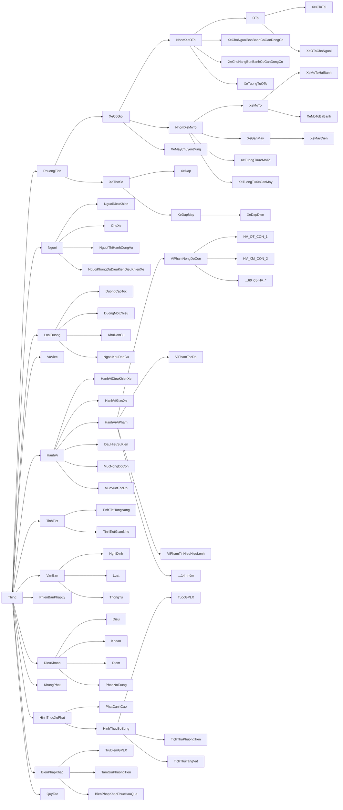
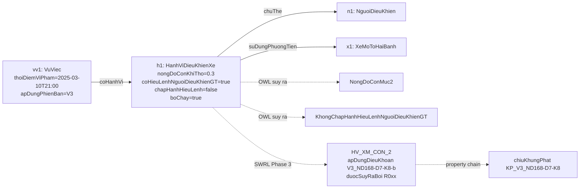

# Thiết kế ontology `traffic_law.owl`

Tài liệu mô tả ontology OWL 2 của hệ chuyên gia tư vấn vi phạm giao thông đường bộ: phạm vi, cấu trúc
lớp và thuộc tính, cách mô hình hóa một vụ việc, cách gắn kết với văn bản pháp luật theo phiên bản,
và các quyết định thiết kế.

## 1. Nguyên tắc

| Nguyên tắc | Cách thực hiện |
|---|---|
| Kết luận pháp lý do reasoner đưa ra | Ngưỡng định lượng là **lớp định nghĩa OWL** (ràng buộc kiểu dữ liệu); luật SWRL (Phase 3) chỉ nối các lớp đó với điều khoản. |
| Truy được về văn bản gốc | Mỗi ngưỡng có annotation `canCuPhapLy` = id phần tử + cụm từ nguyên văn; test `test_threshold_evidence_in_source` kiểm tra cụm từ có thật trong văn bản. Mỗi cá thể điều khoản giữ `noiDung` nguyên văn. |
| Không lấy luật từ trí nhớ | Mọi số liệu (ngưỡng, khung phạt) sinh từ `config/*.yaml` + `data/processed/articles_v*.jsonl`. |
| Áp luật theo thời điểm | Cá thể điều khoản gắn **theo phiên bản** (`V3_ND168-D6-K9-a`); vụ việc có `apDungPhienBan`. |
| Chạy được cả Pellet và HermiT | Không dùng SWRL built-in; ngày dùng `xsd:dateTime` (HermiT không hỗ trợ `xsd:date`). |

## 2. Sinh và chỉnh sửa

```text
config/legal_sources.yaml   ─┐
config/mvp_behaviors.yaml   ─┤
config/ontology_concepts.yaml┼─► python -m src.kb.build_ontology ─► ontology/traffic_law.owl (RDF/XML)
data/processed/articles_v*.jsonl┘
```

* File `.owl` là **sản phẩm sinh ra**. Mở bằng Protégé để xem, kiểm tra, chạy reasoner thử; muốn sửa thì
  sửa file cấu hình (hoặc phần TBox trong `src/kb/build_ontology.py`) rồi sinh lại, để không mất
  liên kết truy vết tới văn bản.
* Nạp trong code: `from src.kb.loader import load_world; world, onto = load_world()` — mỗi vụ việc dùng
  một `World` riêng.
* IRI gốc: `http://www.semanticweb.org/traffic-law-vn/ontology#`.

Số liệu hiện tại: **198 lớp** (67 lớp lõi, 30 lớp ngưỡng/hợp, 27 lớp dấu hiệu sự kiện, 14 nhóm vi phạm,
60 lớp hành vi `HV_*`), **25 thuộc tính đối tượng, 63 thuộc tính dữ liệu, 3 annotation**,
**453 cá thể điều khoản** (46 Điều, 162 Khoản, 245 Điểm — theo 4 phiên bản nghị định và 3 văn bản bổ trợ),
**3 phần nội dung có hiệu lực riêng**, **150 khung phạt**, **20 tình tiết** (8 giảm nhẹ, 12 tăng nặng),
**7 văn bản** (4 nghị định, 2 luật, 1 thông tư).

## 3. Cấu trúc lớp



Ràng buộc rời nhau (`AllDisjoint`):

* `NhomXeOTo`, `NhomXeMoTo`, `XeMayChuyenDung` rời nhau; `XeCoGioi` rời `XeThoSo` — nên khai báo một
  chiếc **xe đạp điện** là thuộc `NhomXeMoTo` sẽ làm ontology **mâu thuẫn** (dùng cho tình huống bẫy:
  xe đạp điện không áp lỗi của xe máy).
* `Dieu`/`Khoan`/`Diem`; `KhuDanCu`/`NgoaiKhuDanCu`; `TinhTietTangNang`/`TinhTietGiamNhe`; và các lớp
  gốc lớn (phương tiện, người, văn bản, …) đôi một rời nhau.

Phân nhóm phương tiện theo đối tượng điều chỉnh của các Điều: `NhomXeOTo` ≈ Điều 5 NĐ 100 / Điều 6 NĐ 168;
`NhomXeMoTo` ≈ Điều 6 NĐ 100 / Điều 7 NĐ 168 ("kể cả xe máy điện"). Xe máy điện là xe gắn máy, xe đạp máy
là xe thô sơ (điểm d, e khoản 1 Điều 3 NĐ 100).

## 4. Thuộc tính

### 4.1. Thuộc tính đối tượng

| Thuộc tính | Miền → Giá trị | Ghi chú |
|---|---|---|
| `coHanhVi` / `thuocVuViec` | VuViec ↔ HanhVi | nghịch đảo nhau; `thuocVuViec` hàm |
| `chuThe` | HanhVi → Nguoi | người thực hiện hành vi |
| `suDungPhuongTien` | HanhVi → PhuongTien | |
| `dieuKhien`, `laChuSoHuu` | Nguoi → PhuongTien | |
| `giaoXeCho` | HanhViGiaoXe → Nguoi | dùng cho lỗi của chủ xe |
| `trenLoaiDuong` | HanhVi → LoaiDuong | |
| `apDungPhienBan` | VuViec → PhienBanPhapLy | do `temporal.py` gán |
| `viPhamHanhVi` | Nguoi → HanhViViPham | luật SWRL gán |
| `apDungDieuKhoan` | HanhVi → DieuKhoan | luật SWRL gán |
| `duocSuyRaBoi` | * → QuyTac | **truy vết**: luật nào sinh ra kết luận |
| `coTinhTiet` | * → TinhTiet | |
| `thuocDieuKhoanCha` ⊑ `thuocDieuKhoan` | DieuKhoan → DieuKhoan | `thuocDieuKhoan` bắc cầu (điểm → khoản → điều) |
| `thuocVanBan`, `duocSuaDoiBoi`, `thuocPhienBan`, `gomVanBan` | | cấu trúc văn bản |
| `coKhungPhat` | DieuKhoan → KhungPhat | chuỗi: `thuocDieuKhoanCha ∘ coKhungPhat ⊑ coKhungPhat` |
| `chiuKhungPhat` | HanhVi → KhungPhat | chuỗi: `apDungDieuKhoan ∘ coKhungPhat ⊑ chiuKhungPhat` |
| `coHinhThucBoSung`, `coBienPhapKhac` | → HinhThucXuPhat / BienPhapKhac | Phase 3 |
| `canCuDieuKhoan`, `apDungChoPhienBan` | QuyTac → DieuKhoan / PhienBanPhapLy | Phase 3 |

Hai **chuỗi thuộc tính (property chain)** cho phép reasoner tự suy ra: điểm a khoản 9 thuộc khoản 9 có
khung phạt 18–20 triệu ⇒ điểm a có khung phạt đó ⇒ hành vi áp dụng điểm a chịu khung phạt đó.

### 4.2. Thuộc tính dữ liệu (sự kiện của vụ việc)

* Số: `nongDoConKhiTho` (mg/L), `nongDoConMau` (mg/100 mL), `tocDoThucTe`, `tocDoToiDaChoPhep`,
  `tocDoVuot` (km/h), `tuoi`, `dungTichXiLanh` (cm3), `congSuatDongCoDien` (kW), `thoiDiemViPham`.
* Boolean trên `HanhViDieuKhienXe` (29 thuộc tính), vd. `khongChapHanhDenTinHieu`, `coHieuLenhNguoiDieuKhienGT`,
  `chapHanhHieuLenh`, `coHieuLenhDungXe`, `boChay`, `doiMuBaoHiem`, `coGPLX`, `mangTheoGPLX`, `kinhDoanhVanTai`…
* Văn bản/điều khoản: `maDieuKhoan`, `trichDan`, `noiDung`, `trangThai`, `hieuLucTu`, `hieuLucDen`,
  `hieuLucChuaXacDinh`; khung phạt: `mucToiThieu`, `mucToiDa`, `doiTuongApDung`.

## 5. Khái niệm định nghĩa (OWL reasoner tự phân loại)

### 5.1. Ngưỡng pháp lý — `config/ontology_concepts.yaml › thresholds`

Mỗi lớp = `<lớp miền> ⊓ ∃<thuộc tính>.<kiểu dữ liệu>[facet]`, kèm căn cứ:

| Lớp | Định nghĩa | Căn cứ (ví dụ) |
|---|---|---|
| `NongDoConKhiThoMuc1/2/3` | (0; 0,25] · (0,25; 0,4] · > 0,4 mg/L | V3 `ND168-D6-K6-c`, `-K9-a`, `-K11-a` |
| `NongDoConMauMuc1/2/3` | (0; 50] · (50; 80] · > 80 mg/100 mL | như trên |
| `NongDoConMuc1/2/3` | hợp "máu **hoặc** hơi thở" | |
| `VuotTocDo05Den10` | [5; 10) km/h | "từ 05 km/h đến dưới 10 km/h" |
| `VuotTocDo10Den20` | [10; 20] | "từ 10 km/h đến 20 km/h" |
| `VuotTocDoTren20Den35`, `VuotTocDoTren35` | (20; 35] · > 35 (ô tô) | |
| `VuotTocDoTren20` | > 20 (xe máy) — reasoner tự suy ra `VuotTocDoTren20Den35 ⊑ VuotTocDoTren20` | |
| `NguoiTu14Den16Tuoi`, `NguoiTu16Den18Tuoi` | [14; 16) · [16; 18) | `ND168-D18-K1`, `-K6` |
| `DungTichDuoi175cm3`, `DungTichTu175cm3` | phân hạng NĐ 100 | `ND100-D21-K5`, `-K7` |
| `DungTichDen125cm3`, `CongSuatDen11kW`, `XeMoToHangNhoND168` … | phân hạng NĐ 168 | `ND168-D18-K5`, `-K7` |
| `DungTichTu50cm3`, `CongSuatTu4kW`, `XeMoToTu50cm3Hoac4kW` | | `ND100-D21-K4-a`, `ND168-D18-K4-a` |

Biên được kiểm tra trong test: 0,25 mg/L → mức 1; 4 km/h → không thuộc mức nào; 10 và 20 km/h → `VuotTocDo10Den20`;
18 tuổi → không thuộc nhóm 16–18.

### 5.2. Dấu hiệu sự kiện — `observations`

Lớp ghép từ giá trị boolean (và ràng buộc lớp), vd.

* `KhongChapHanhHieuLenhNguoiDieuKhienGT ≡ HanhViDieuKhienXe ⊓ coHieuLenhNguoiDieuKhienGT = true ⊓ chapHanhHieuLenh = false`
* `DiNguocChieuTrenCaoToc ≡ HanhViDieuKhienXe ⊓ diNguocChieu = true ⊓ ∃trenLoaiDuong.DuongCaoToc`
* `KhongMangTheoGPLX ≡ HanhViDieuKhienXe ⊓ coGPLX = true ⊓ mangTheoGPLX = false`

## 6. Mô hình hóa một vụ việc (ABox)

Ví dụ: *"Tối 10/3/2025 tôi uống bia rồi chạy xe máy, thấy CSGT vẫy thì rồ ga chạy; đo được 0,3 mg/L."*



* `fact_builder` tạo cá thể; các sự kiện *gián tiếp* (`coHieuLenhNguoiDieuKhienGT`, `boChay`) do `fact_inducer`
  suy ra kèm độ tin cậy.
* `tocDoVuot` do `fact_builder` tính (`tocDoThucTe − tocDoToiDaChoPhep`) vì OWL không có phép trừ — đây là phép
  tính số học, không phải kết luận pháp lý.
* Lỗi của **chủ xe** là một cá thể `HanhViGiaoXe` riêng (`chuThe` = chủ xe, `giaoXeCho` = người lái). Phase 3
  sẽ suy ra `NguoiKhongDuDieuKienDieuKhienXe` từ chính vi phạm của người lái (chưa đủ tuổi, không có GPLX) rồi
  mới kết luận lỗi giao xe — một chuỗi suy luận gián tiếp hai bước.

## 7. Điều khoản theo phiên bản

* Cá thể `V{n}_{id}` thuộc `Dieu`/`Khoan`/`Diem`, có `thuocPhienBan`, `thuocVanBan` (văn bản gốc của id),
  `duocSuaDoiBoi` (NĐ 123 ở V2, NĐ 238 ở V4 nếu phần tử bị sửa), `noiDung`, `trichDan`, `hieuLucTu/Den`.
* Cùng một id ở hai phiên bản là **hai cá thể khác nhau** (vd. `V1_ND100-D5-K4` 1–2 triệu, `V2_ND100-D5-K4` 2–3 triệu).
* Chỉ nạp các phần tử được hành vi MVP hoặc ngưỡng dẫn tới, cùng khoản/điều cha (để reasoner nhanh); nguyên
  văn đầy đủ vẫn ở `articles_v*.jsonl` cho RAG.
* Khung phạt `KP_V3_ND168-D6-K9` gắn vào khoản; nếu khoản có mức riêng cho tổ chức thì có thêm `KP_TC_…`.

### 7.1. Hiệu lực tới cấp phần nội dung, hiệu lực có điều kiện

* Phần tử có hiệu lực riêng do văn bản quy định (Điều 53 NĐ 168, Điều 18 NĐ 238, Điều 88 Luật TTATGT) được
  khai báo ở `element_effectivity` trong `config/legal_sources.yaml` và luôn được nạp vào ontology.
* `hieuLucDieuKien` + `dieuKienDaDapUng = false`: hiệu lực còn phụ thuộc văn bản khác ⇒ hệ thống coi là chưa có
  hiệu lực, kể cả khi đã qua ngày ghi trong văn bản.
* Khi chỉ một phần nội dung của điểm có hiệu lực riêng, phần đó là cá thể `PhanNoiDung` (vd.
  `V4_ND168-D20-K5-l__P1`: phần về thiết bị ghi hình người lái của xe dưới 08 chỗ, từ 01/01/2028) gắn với
  điểm qua `thuocDieuKhoanCha`; điểm có `hieuLucMotPhan = true`.
* Đánh giá tại một ngày: `src/kb/temporal.py`. Ví dụ đầy đủ cho báo cáo: `docs/report/vi_du_hieu_luc_co_dieu_kien.md`.

### 7.2. Văn bản bổ trợ

| Khóa | Văn bản | Hiệu lực | Dùng cho |
|---|---|---|---|
| `GTDB2008` | Luật Giao thông đường bộ 23/2008/QH12 | 01/07/2009 – 31/12/2024 | điều kiện người lái (Điều 58), độ tuổi (Điều 60) — vi phạm thuộc V1, V2 |
| `LTTATGT_2025` / `_2026A` / `_2026B` | Luật TTATGT 36/2024/QH15 và các bản hợp nhất Luật 118/2025/QH15 | 2025 / 01–06/2026 / từ 01/07/2026 | điều kiện người lái (Điều 56), hạng GPLX (Điều 57), độ tuổi (Điều 59) — V3, V4 |
| `TT31` | Thông tư 31/2019/TT-BGTVT | 15/10/2019 – 31/12/2024 | tốc độ tối đa khi không có biển báo — V1, V2 |
| `TT38` | Thông tư 38/2024/TT-BGTVT | từ 01/01/2025 | tốc độ tối đa khi không có biển báo — V3, V4 |
| `LXLVPHC` | Luật Xử lý VPHC (hợp nhất 90/VBHN-VPQH) | gốc 01/07/2013; câu chữ từng phần tử theo chú thích | tình tiết (Điều 9, 10), mức phạt cụ thể (khoản 4 Điều 23), đối tượng (Điều 5), người chưa thành niên (Điều 134) |

* Văn bản được chọn theo ngày vi phạm qua `support_roles` (`dieu_kien_nguoi_lai`, `toc_do_toi_da`, `xu_ly_vphc`)
  và hàm `temporal.chon_van_ban_bo_tro`. Bảng tốc độ của cả TT 31 và TT 38: `data/processed/speed_limits.json`.
* Văn bản bổ trợ có nhiều phiên bản (Luật TTATGT) dùng tên cá thể có tiền tố phiên bản
  (`LTTATGT_2025_LTTATGT-D59-K1-b`) và có cá thể `PhienBanPhapLy` riêng.
* Cá thể điều khoản bổ trợ dùng id làm tên (`LXLVPHC-D23-K4`), không có tiền tố phiên bản.
* Với văn bản hợp nhất, ngày hiệu lực câu chữ hiện hành của từng phần tử lấy từ chú thích `[n]`; trước ngày
  đó, `noiDungTruocDo` ghi rõ câu chữ cũ không có trong dữ liệu.
* Tình tiết: mỗi khoản Điều 9 → một cá thể `TinhTietGiamNhe` (`TTGN_1`…`TTGN_8`), mỗi điểm khoản 1 Điều 10 →
  một cá thể `TinhTietTangNang` (`TTTN_a`…`TTTN_m`), có `canCuDieuKhoan` trỏ tới điều khoản.
* Ngưỡng tuổi mới (`thresholds_luat`): `NguoiChuaDu14Tuoi` (suy ra từ phạm vi Điều 5 Luật XLVPHC),
  `NguoiTu16TuoiTroLen`, `NguoiTu18TuoiTroLen` (Điều 59 Luật TTATGT).

## 8. Định hướng cho luật SWRL (Phase 3)

Luật **không dùng built-in**, chỉ nối lớp đã phân loại với phiên bản và điều khoản:

```text
HanhViDieuKhienXe(?h) ∧ suDungPhuongTien(?h, ?x) ∧ NhomXeMoTo(?x) ∧ NongDoConMuc2(?h)
  ∧ thuocVuViec(?h, ?v) ∧ apDungPhienBan(?v, V3)
  → HV_XM_CON_2(?h) ∧ apDungDieuKhoan(?h, V3_ND168-D7-K8-b) ∧ duocSuyRaBoi(?h, R0xx)
```

Cá thể `R0xx` (lớp `QuyTac`) mang `ketLuanMaHanhVi`, `canCuDieuKhoan`, `apDungChoPhienBan`, nên `tracer.py`
dựng lại được chuỗi: sự kiện → lớp định nghĩa → quy tắc → hành vi → điều khoản → khung phạt.

## 9. Quyết định thiết kế và đánh đổi

1. **Giả định thế giới mở (OWA).** OWL không suy ra "không mang GPLX" từ việc thiếu thông tin. Vì vậy sự kiện
   phủ định được ghi tường minh bằng boolean (`mangTheoGPLX = false`), và `slot_checker` phải hỏi lại khi
   trường quyết định chưa có giá trị. Đây cũng là cơ chế "thiếu thông tin thì hỏi lại".
2. **Hành vi vi phạm là lớp, hành vi thực tế là cá thể.** Một lượt điều khiển xe có thể thuộc nhiều lớp
   `HV_*` (vừa có cồn vừa quá tốc độ); quan hệ hành vi ↔ điều khoản đi qua cá thể quy tắc nên không bị nhập nhằng.
3. **Tên lớp hành vi `HV_<mã>`** dùng đúng mã trong `config/mvp_behaviors.yaml` (ổn định xuyên suốt registry,
   test, đánh giá) thay vì CamelCase tự đặt; nhãn tiếng Việt nằm ở `rdfs:label`.
4. **Ngày dạng `xsd:dateTime`** để HermiT (dự phòng) chạy được.
5. **Ngưỡng dùng chung cho mọi phiên bản** vì 4 phiên bản dùng cùng ranh giới (đã đối chiếu V1 và V3 trong
   evidence). Phân hạng xe khác nhau giữa NĐ 100 (175 cm3) và NĐ 168 (125 cm3/11 kW) được tách thành lớp riêng;
   luật của từng phiên bản chọn lớp phù hợp.
6. Phiên bản V4 (NĐ 238) **bỏ ngưỡng 50 cm3** ở điểm a khoản 4 Điều 18 (người 16–18 tuổi đi mô tô): luật V4 sẽ
   không dùng `XeMoToTu50cm3Hoac4kW` cho hành vi này.

## 10. TODO_VERIFY

* Luật GTĐB 2008 trong `data/raw/` là bản gốc; các sửa đổi của Luật 35/2018/QH14 và 44/2019/QH14 (được khoản 3
  Điều 88 Luật TTATGT nêu) chưa có. Điều 58, 60 dùng cho MVP không thuộc phần được biết là đã sửa, nhưng chưa
  kiểm chứng được.
* TT 31/2019 có thể đã bị sửa bởi Điều 15 TT 06/2023/TT-BGTVT (TT 38 có dẫn) — chưa có văn bản.
* Luật XLVPHC chỉ có bản hợp nhất 2026: với vi phạm trước ngày câu chữ hiện hành có hiệu lực (vd. khoản 4
  Điều 23 trước 01/01/2022), hệ thống báo thiếu dữ liệu câu chữ tại thời điểm đó.
* Trước 15/10/2019 không có thông tư tốc độ trong dữ liệu (ngoài phạm vi V1–V4).
