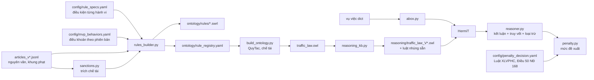

# Luật SWRL, suy luận và quyết định mức phạt (Phase 3)

## 1. Luồng xử lý



Sinh lại toàn bộ: `python -m scripts.build_all` (khoảng 6 giây).

## 2. Luật

| Loại | Số luật | Tệp |
|---|---|---|
| Hành vi vi phạm (60 hành vi × phiên bản có quy định, kể cả các phương án "hoặc") | 257 | alcohol, speed, signal, resistance, documents |
| Suy ra người không đủ điều kiện điều khiển xe | 32 | documents |
| Tình tiết tăng nặng/giảm nhẹ | 14 | penalty_decision |
| **Tổng** | **303** | 84–88 luật mỗi phiên bản |

Mẫu luật hành vi (không dùng built-in; ngưỡng là lớp OWL định nghĩa):

```text
R007: HanhViDieuKhienXe(?h), thuocVuViec(?h, ?v), apDungPhienBan(?v, V3), chuThe(?h, ?n),
      suDungPhuongTien(?h, ?x), NhomXeOTo(?x), NongDoConMuc2(?h)
   -> HV_OT_CON_2(?h), QT_R007(?h), apDungDieuKhoan(?h, V3_ND168-D6-K9-a), duocSuyRaBoi(?h, R007),
      viPhamHanhVi(?n, ?h)
```

* Điều kiện "hoặc" (vd. mô tô hai bánh đến 125 cm3 **hoặc** xe tương tự mô tô) sinh nhiều luật cùng hành vi.
* Khác biệt theo phiên bản khai ở `phien_ban` trong đặc tả, ví dụ:
  * lỗi không mang GPLX/đăng ký ở V3, V4 cần thêm `XeKinhDoanhVanTai`;
  * phân hạng mô tô 175 cm3 (NĐ 100) và 125 cm3/11 kW (NĐ 168);
  * NĐ 238 bỏ ngưỡng 50 cm3 với người 16–18 tuổi.
* **Suy luận hai bước** (lỗi chủ xe):
  * Bước 1: người lái có kết luận `HV_CHUA_DU_TUOI_*` hoặc `HV_*_KHONG_GPLX`, hoặc dưới 14 tuổi mà điều khiển xe
    cơ giới, ⇒ `NguoiKhongDuDieuKienDieuKhienXe`.
    Căn cứ: Điều 58, 60 Luật GTĐB 2008 (V1, V2) hoặc Điều 56, 59 Luật TTATGT (V3, V4).
  * Bước 2: chủ xe `giaoXeCho` người đó ⇒ `HV_CHU_*_GIAO_XE`.

### 2.1. Sổ đăng ký `ontology/rule_registry.yaml`

* `quy_tac.<mã>`: gồm các trường sau.
  * `loai`, `ma_hanh_vi`, `phien_ban`, `tep`, `swrl`.
  * `can_cu`: văn bản, điều, khoản, điểm, trích dẫn, **nguyên văn**, `hieu_luc_tu/den`, đã bị sửa đổi hay chưa.
* `hanh_vi.<mã>.phien_ban.<V>`: gồm các trường sau.
  * `quy_tac`, `can_cu`, `khung_phat` (lấy từ khoản), `canh_cao`.
  * `che_tai`: các hình thức bổ sung và trừ điểm áp cho điều khoản đó.
  * `loai_tru_boi`: hành vi loại trừ hành vi này, kèm căn cứ.
* Sổ đăng ký được sinh tự động; không có số liệu pháp lý nào gõ tay.

### 2.2. Hình thức bổ sung, trừ điểm (`sanctions.py`)

Trích tự động từ câu chữ các khoản "Ngoài việc bị phạt tiền…". Mỗi mệnh đề có đủ các thông tin sau:
* **loại**: tước GPLX, trừ điểm, tịch thu phương tiện, tịch thu khác hoặc thu hồi;
* **giá trị**: số tháng, số điểm;
* **đích**: điều/khoản/điểm được dẫn;
* **điều kiện**: tái phạm, vi phạm nhiều lần, gây tai nạn, "trong trường hợp…";
* câu nguyên văn làm căn cứ.

Kết quả: 43/41/49/49 mệnh đề cho V1/V2/V3/V4, ứng với 82 cá thể chế tài trong ontology (gắn bằng `coHinhThucBoSung`/`coBienPhapKhac`).

### 2.3. Loại trừ

"trừ hành vi vi phạm quy định tại…" và nguyên tắc "một hành vi chỉ bị xử phạt một lần" (điểm d khoản 1 Điều 3
Luật XLVPHC) được khai ở `loai_tru_boi`. Ví dụ: đi ngược chiều trên cao tốc thì không áp thêm lỗi đi ngược chiều thường; từ chối đo cồn thì không áp thêm lỗi không chấp hành yêu cầu kiểm tra.

## 3. Reasoner

**HermiT** là reasoner chính, đi ngược với đề xuất ban đầu dùng Pellet. Lý do có số đo (`tests/test_rules.py::test_pellet_limitation`):

| | Ví dụ V3 (20) | Tình huống bẫy (12) |
|---|---|---|
| Pellet 2.3.1 (owlready2) | bỏ sót 20/20 | sai 6/12 |
| HermiT | đúng 20/20 | đúng 12/12 |

Pellet bỏ sót kết luận của luật có lớp ngưỡng trong thân luật khi ontology có đủ bộ luật, và không trả về giá
trị thuộc tính do luật suy ra.

Tối ưu hiệu năng:
1. **Ontology suy luận theo phiên bản** (`reasoning_kb.py`): chỉ giữ khoảng 230 cá thể cần thiết (thay vì 1.076) và nhúng sẵn luật của phiên bản.
2. **Lớp đánh dấu `QT_<mã>`** thay cho suy luận mọi giá trị thuộc tính (tốn O(n²)). Truy vết đọc từ lớp đánh dấu.
3. **Chia lô 10 vụ việc** cho mỗi lần gọi HermiT.

| Đo | Thời gian |
|---|---|
| 1 vụ việc (gồm khởi động JVM) | ≈ 1,7 s |
| 3 vụ việc / 3 phiên bản — trước tối ưu | 55 s |
| 3 vụ việc / 3 phiên bản — sau tối ưu | 8,6 s |
| 60 vụ việc một phiên bản (lô 10) | ≈ 32 s |

## 4. Quyết định mức phạt (`penalty.py`, `config/penalty_decision.yaml`)

| Quy tắc | Căn cứ |
|---|---|
| Mức cụ thể = trung bình khung; giảm nhẹ/tăng nặng không vượt biên khung | khoản 4 Điều 23 Luật XLVPHC |
| Nhiều hành vi → xử phạt từng hành vi, cộng tiền | điểm d khoản 1 Điều 3 Luật XLVPHC |
| Tổ chức = 2 lần cá nhân | điểm e khoản 1 Điều 3 Luật XLVPHC |
| Dưới 14 tuổi: không xử phạt (suy ra từ phạm vi Điều 5) | điểm a khoản 1 Điều 5 Luật XLVPHC |
| 14–16 tuổi: chỉ khi cố ý, không phạt tiền (cảnh cáo) | điểm a khoản 1 Điều 5, khoản 3 Điều 134 |
| 16–18 tuổi: không quá 1/2 mức người thành niên | khoản 3 Điều 134 |
| Tình tiết đã là dấu hiệu của hành vi thì không tính tăng nặng | khoản 2 Điều 10 |
| Nhiều hành vi bị trừ điểm → chỉ trừ mức cao nhất; không quá số điểm còn lại; không trừ khi GPLX đang bị tước | điểm b, c, đ khoản 1 Điều 50 NĐ 168 |
| Chế tài có điều kiện (tái phạm, gây tai nạn) chỉ áp khi sự kiện có trong vụ việc; điều kiện "trong trường hợp…" được nêu để người dùng kiểm tra | câu chữ từng khoản |

Mọi câu trích ở cấu hình đều được test đối chiếu với văn bản nguồn. Riêng **mức tăng/giảm cụ thể theo số tình tiết** là quy ước của hệ thống: mỗi tình tiết (tăng trừ giảm) dịch ½ khoảng từ mức trung bình tới biên khung, tối đa 2 bước. Lý do là khoản 4 Điều 23 giao "Chính phủ quy định chi tiết khoản này", mà văn bản đó chưa có trong dữ liệu (TODO_VERIFY).

Khi căn cứ của Luật XLVPHC chưa có câu chữ tại ngày vi phạm (bản hợp nhất), quyết định ghi chú rõ. Ví dụ khoản 4 Điều 23 với vi phạm năm 2021.

## 5. Kiểm thử

* `test_rules.py`:
  * sổ đăng ký truy được căn cứ; luật không dùng built-in; mọi tên trong luật có trong ontology;
  * **tình huống mẫu của cả 60 hành vi ở cả 4 phiên bản** cho đúng điều khoản, không kết luận thừa;
  * 12 tình huống bẫy;
  * cùng hành vi ở 4 thời điểm cho 4 căn cứ khác nhau;
  * truy vết suy luận hai bước;
  * hạn chế của Pellet.
* `test_sanctions.py`: trích chế tài (có/không điều kiện, khoản dẫn "Tịch thu… sau đây:", trừ điểm).
* `test_penalty.py`: trích dẫn có thật; mức trung bình; giảm nhẹ; 16–18 và 14–16 tuổi; nhiều hành vi trừ điểm; tịch
  thu khi tái phạm mà không tính trùng tình tiết; ghi chú hiệu lực cho vi phạm năm 2021.

## 6. TODO_VERIFY

* Mức tăng/giảm theo tình tiết: chờ văn bản hướng dẫn chi tiết khoản 4 Điều 23 Luật XLVPHC.
* Lỗi "giao xe cho người không đủ điều kiện" hiện chỉ suy ra "không đủ điều kiện" từ tuổi và GPLX. Các điều kiện khác ở Điều 56 Luật TTATGT (sức khỏe, GPLX còn điểm…) chưa mô hình.
* Người 14–16 tuổi chỉ bị xử phạt khi vi phạm **do cố ý**. Hệ thống không suy ra được yếu tố lỗi, nên câu trả lời phải nêu điều kiện này.
* Hành vi trong khoản dẫn "Tịch thu phương tiện… sau đây:" mà không dẫn chiếu điều khoản khác (vd. điểm a, b khoản 11 Điều 7 NĐ 168: buông hai tay…) nằm ngoài MVP, chưa có luật.
