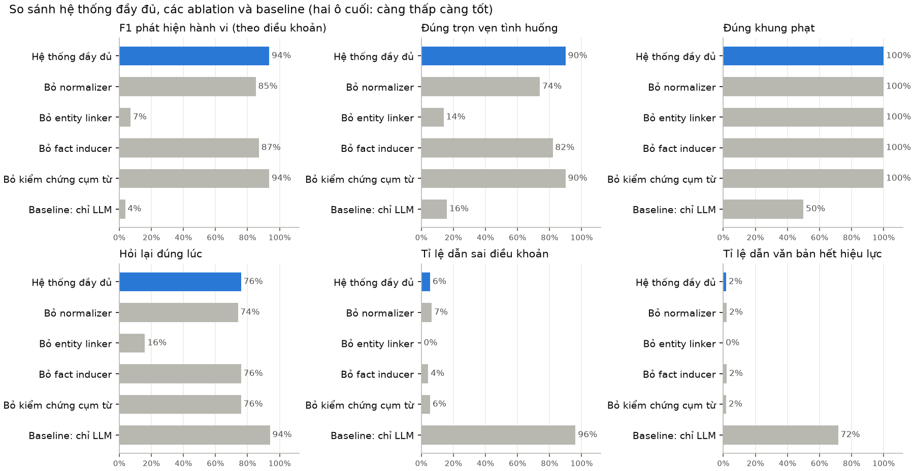
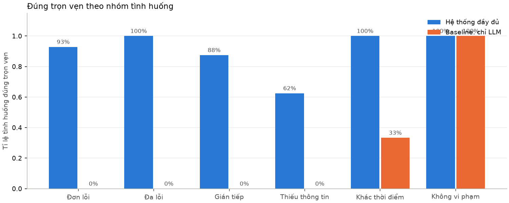
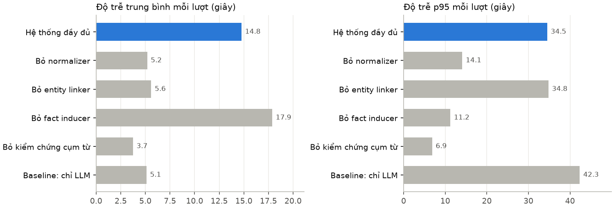

# Kết quả đánh giá

_Sinh tự động bởi `python -m evaluation.bao_cao` từ 50 tình huống trong `data/test/scenarios.jsonl` (hướng dẫn gán nhãn: `data/test/annotation_guide.md`). LLM: Gemini (temperature 0, có cache)._

## Tóm tắt

Trên 50 tình huống (6 nhóm), hệ thống đầy đủ đạt **F1 phát hiện hành vi 95,4%** (theo mã) / **93,6%** (theo điều
khoản, khớp tới điểm), **90% tình huống đúng trọn vẹn**, **100% đúng khung phạt** khi đã xác định đúng điều khoản,
**97,9% đúng phiên bản pháp lý**. Baseline chỉ dùng LLM (cùng model Gemini, trả lời từ kiến thức sẵn có) chỉ đạt
**3,7%** F1 theo điều khoản và **16%** tình huống đúng trọn vẹn — gần như toàn bộ là các tình huống không vi phạm.

| | Hệ thống đầy đủ | Baseline chỉ LLM |
|---|---|---|
| Đúng trọn vẹn | 90,0% | 16,0% |
| F1 điều khoản (khớp tới điểm) | 93,6% | 3,7% |
| Dẫn văn bản hết hiệu lực (trên số căn cứ được dẫn) | 1,9% | 71,7% |
| Dẫn sai điều khoản | 5,6% | 96,2% |
| Độ trễ trung bình / p95 mỗi lượt | 14,8 s / 34,5 s | 5,1 s / 42,3 s |

## Vì sao baseline thấp

- **Dẫn văn bản hết hiệu lực:** 42/53 căn cứ baseline đưa ra là NĐ 100/2019, kể cả cho vụ việc năm 2025–2026 (đã
  được thay bằng NĐ 168/2024 từ 01/01/2025). Câu trả lời của baseline nhắc văn bản hết hiệu lực ở 14 tình huống.
- **Khi có dẫn NĐ 168 thì giữ số điều của NĐ 100:** vd. S06 dẫn "Điều 5 NĐ 168" cho lỗi ô tô đi ngược chiều — Điều 5
  là số điều của NĐ 100; trong NĐ 168 lỗi ô tô nằm ở Điều 6.
- **Không phân biệt phiên bản trong cùng NĐ 100:** S39 (năm 2023) dẫn đúng điểm a khoản 5 Điều 5 nhưng khung
  3–5 triệu là mức của NĐ 100 *trước* khi NĐ 123/2021 sửa thành 4–6 triệu.
- Baseline đúng ở nhóm không vi phạm (6/6) vì chỉ cần không đưa ra kết luận.

Đây là đúng loại rủi ro mà thiết kế "LLM không quyết định điều khoản" nhắm tới: kết luận của hệ thống do reasoner
chạy trên luật SWRL truy về văn bản có hiệu lực tại ngày vi phạm, nên sai sót của LLM ở tầng ngôn ngữ không trở thành
sai căn cứ pháp lý.

## Ablation

- **Bỏ entity linker** (chỉ khớp đúng nhãn node của ontology, không từ điển đồng nghĩa, không embedding): F1 điều
  khoản còn 7%, đúng trọn vẹn 14% (gần như chỉ còn nhóm không vi phạm). Hệ thống không nhận ra "ô tô", "xe máy",
  "vượt đèn đỏ"... nên liên tục hỏi lại loại xe và hành vi. Đây là tầng quan trọng nhất của Bài toán 2.
- **Bỏ normalizer** (chỉ đọc chữ số và ngày dd/mm/yyyy): đúng trọn vẹn giảm 16 điểm (90% → 74%); nhóm khác thời
  điểm còn 66,7% và đa lỗi 75% — hệ thống không đọc được "0,3 mg/l" (dấu phẩy thập phân), "hôm qua", "75 km/h"
  trong câu có nhiều số.
- **Bỏ fact inducer**: F1 điều khoản giảm 6,5 điểm, nhóm gián tiếp giảm mạnh nhất (87,5% → 50%), tỉ lệ sự kiện then
  chốt đúng giảm từ 93% xuống 70% — các hành vi phải suy ra ("rồ ga chạy khi CSGT vẫy", "quẹt ngã rồi chạy luôn")
  không còn được kết luận. Đây là phần LLM đóng góp cho Bài toán 1.
- **Bỏ kiểm chứng cụm từ**: không khác biệt trên bộ này — Gemini không tự thêm thông tin ở 50 tình huống. Tác dụng của
  bước này đã thấy khi thử Ollama/qwen2.5 ở Phase 4 (chặn 3/4 lần bịa loại xe, ngày). Bộ tình huống hiện chưa có ca
  gài LLM bịa thông tin nên không đo được — nên bổ sung ở vòng sau.

## Phân tích lỗi của hệ thống đầy đủ (13 tình huống chưa hoàn hảo)

| Tầng | Tình huống | Nguyên nhân | Hướng sửa |
|---|---|---|---|
| Hội thoại — hỏi xác nhận | S14, S21, S24, S29, S45 (lượt đầu) | Hành vi được ánh xạ bằng embedding (đúng) nên hệ thống hỏi xác nhận trước khi dùng — thận trọng theo thiết kế, nhưng cho thấy từ điển đồng nghĩa còn thiếu cách nói ("chạy vào làn xe buýt", "đèn đã đỏ vẫn cố chạy qua") | Bổ sung `synonyms.json`; nếu tính không kể câu xác nhận, tỉ lệ hỏi đúng lúc là 88% thay vì 76% |
| Hội thoại — hỏi không dứt | S45, S46 | Lời kể không vi phạm (dừng đúng đèn đỏ; uống rượu nhưng đi taxi) → không có sự kiện nào ánh xạ được nên hệ thống hỏi lại mãi | Khi người dùng trả lời mà hồ sơ không thay đổi, dừng hỏi và kết luận "không phát hiện vi phạm" kèm ghi chú |
| Hội thoại — hỏi sai hướng | S26 | Embedding gán "chạy luôn không dừng lại" thành gợi ý *tốc độ* → hỏi tốc độ và đặc điểm đường thay vì kết luận gây tai nạn bỏ trốn | Không dùng embedding cho gợi ý (gợi ý chỉ để chọn câu hỏi, sai thì gây hỏi thừa) |
| Hội thoại — bỏ sót câu hỏi | S37 | Gợi ý "CSGT" bị coi là đã mô tả hành vi → không hỏi "bạn vi phạm gì" | Gợi ý không phải hành vi: không tính khi xét "đã mô tả hành vi" |
| Thời điểm | S36 | "Từ 28/12/2024 đến 3/1/2025" chỉ được đọc ngày đầu → áp V2 (NĐ 100) thay vì hỏi ngày chính xác | Normalizer đọc khoảng "từ … đến …" để slot checker phát hiện khoảng vắt qua hai phiên bản |
| Suy luận | S10 | "Chở bạn không đội mũ, còn tôi có đội" → từ điển khớp cụm "không đội mũ bảo hiểm" cho cả người lái | Thêm cụm "ngồi sau không đội mũ…" vào từ điển (khớp dài nhất thắng) |
| Ánh xạ | S35 | "Không có giấy tờ xe" được hiểu thẳng là không có đăng ký xe, thay vì hỏi giấy tờ nào và có hay chỉ quên mang | Bỏ cụm mơ hồ khỏi mục "không có đăng ký", để gợi ý "giấy tờ" kích hoạt câu hỏi |
| Hội thoại | S25 | Hỏi lại "có kinh doanh vận tải không" dù lời kể có "chở hàng thuê cho ứng dụng giao hàng" (vẫn kết luận đúng) | Bổ sung ví dụ cho fact inducer / từ điển |

Khung phạt đúng 100% khi điều khoản đúng — mọi sai sót nằm ở tầng hiểu ngôn ngữ và hội thoại, không nằm ở cơ sở
tri thức (luật SWRL, sổ đăng ký điều khoản).

## Lưu ý khi đọc số liệu

- **Độ trễ** gồm cả thời gian chờ do giới hạn 10 lượt gọi/phút của gói Gemini miễn phí (mỗi lượt gọi LLM tối đa 3
  lần: trích xuất, suy ra sự kiện, diễn đạt) và khoảng 3 giây chạy HermiT. Độ trễ của các ablation **không so sánh
  được** với hệ thống đầy đủ vì phần lớn lượt gọi đã có trong cache và ablation không chạy bước diễn đạt.
- 50 tình huống do nhóm phát triển soạn; nhãn điều khoản tra từ cùng bảng hành vi ↔ điều khoản mà hệ thống dùng (bảng
  đã kiểm chứng với văn bản gốc). Phép đo vì vậy kiểm tra hệ thống có **đi tới đúng hành vi** từ lời kể hay không,
  không kiểm tra lại bảng đó.
- Chạy một lần với temperature 0; phản hồi LLM được cache nên chạy lại cho cùng kết quả.

## 1. Bảng tổng hợp

| Cấu hình | F1 hành vi | F1 điều khoản | Đúng trọn vẹn | Đúng khung phạt | Đúng phiên bản | Hỏi đúng lúc | Dẫn sai | Dẫn hết hiệu lực | Trễ TB / p95 (s) | Lỗi chạy |
|---|---|---|---|---|---|---|---|---|---|---|
| Hệ thống đầy đủ | 95.4% | 93.6% | 90.0% | 100.0% | 97.9% | 76.0% | 5.6% | 1.8% | 14.766 / 34.507 | 0/50 |
| Bỏ normalizer | 87.1% | 85.2% | 74.0% | 100.0% | 97.8% | 74.0% | 6.5% | 2.2% | 5.189 / 14.091 | 0/50 |
| Bỏ entity linker | 7.0% | 7.0% | 14.0% | 100.0% | 100.0% | 16.0% | 0.0% | 0.0% | 5.597 / 34.8 | 0/50 |
| Bỏ fact inducer | 89.1% | 87.1% | 82.0% | 100.0% | 97.7% | 76.0% | 4.3% | 2.2% | 17.884 / 11.24 | 0/50 |
| Bỏ kiểm chứng cụm từ | 95.4% | 93.6% | 90.0% | 100.0% | 97.9% | 76.0% | 5.6% | 1.8% | 3.744 / 6.86 | 0/50 |
| Baseline: chỉ LLM | — | 3.7% | 16.0% | 50.0% | — | 94.0% | 96.2% | 71.7% | 5.117 / 42.33 | 0/50 |

F1 hành vi: so theo mã hành vi (baseline không có mã nên để trống). F1 điều khoản: so theo id điều khoản khớp tới điểm. Đúng trọn vẹn: tập điều khoản dự đoán trùng khít nhãn (kể cả tình huống không vi phạm). Dẫn sai / hết hiệu lực: tính trên mọi căn cứ được dẫn.







## 2. Trích xuất, ánh xạ, suy ra sự kiện (hệ thống đầy đủ)

| Trường | F1 |
|---|---|
| dung_tich_xi_lanh | 100.0% |
| loai_xe | 100.0% |
| ngay | 91.7% |
| nong_do_con_khi_tho | 100.0% |
| toc_do_thuc_te | 100.0% |
| toc_do_toi_da | 100.0% |

- Sự kiện then chốt đúng (kể cả sự kiện phải suy ra): 93.0%
- Node dấu hiệu kỳ vọng có trong kết quả (ánh xạ node): 95.5%
- Hỏi thừa ở lượt đầu: 9 tình huống; bỏ sót câu hỏi cần thiết: 3
- Hỏi xác nhận ở lượt đầu: 6 tình huống; hỏi đúng lúc nếu không tính câu xác nhận: 88.0% (so với 76.0% khi tính)

## 3. Theo nhóm tình huống

| Nhóm | n | Hệ thống đầy đủ | Bỏ normalizer | Bỏ entity linker | Bỏ fact inducer | Bỏ kiểm chứng cụm từ | Baseline: chỉ LLM |
|---|---|---|---|---|---|---|---|
| Đơn lỗi | 14 | 92.9% | 78.6% | 0.0% | 92.9% | 92.9% | 0.0% |
| Đa lỗi | 8 | 100.0% | 75.0% | 0.0% | 75.0% | 100.0% | 0.0% |
| Gián tiếp | 8 | 87.5% | 87.5% | 12.5% | 50.0% | 87.5% | 0.0% |
| Thiếu thông tin | 8 | 62.5% | 37.5% | 0.0% | 75.0% | 62.5% | 0.0% |
| Khác thời điểm | 6 | 100.0% | 66.7% | 0.0% | 100.0% | 100.0% | 33.3% |
| Không vi phạm | 6 | 100.0% | 100.0% | 100.0% | 100.0% | 100.0% | 100.0% |

(Giá trị: tỉ lệ tình huống đúng trọn vẹn.)

## 4. Ablation — thay đổi so với hệ thống đầy đủ

| Cấu hình | Δ F1 điều khoản | Δ Đúng trọn vẹn | Δ Hỏi đúng lúc | Δ Trường loai_xe F1 |
|---|---|---|---|---|
| Bỏ normalizer | -8.4 điểm | -16.0 điểm | -2.0 điểm | +0.0 điểm |
| Bỏ entity linker | -86.6 điểm | -76.0 điểm | -60.0 điểm | -96.0 điểm |
| Bỏ fact inducer | -6.5 điểm | -8.0 điểm | +0.0 điểm | +0.0 điểm |
| Bỏ kiểm chứng cụm từ | +0.0 điểm | +0.0 điểm | +0.0 điểm | +0.0 điểm |

## 5. Phân tích lỗi theo tầng (hệ thống đầy đủ)

| Tầng gây lỗi đầu tiên | Số tình huống |
|---|---|
| hội thoại: hỏi thừa / bỏ sót câu hỏi | 6 |
| hội thoại: hỏi lại không dứt (không kết luận) | 3 |
| ánh xạ node / suy ra sự kiện | 2 |
| suy luận / luật (đầu vào đúng nhưng kết luận sai) | 1 |
| thời điểm: sai phiên bản pháp lý | 1 |

Chi tiết các tình huống chưa đúng:

- **S10** (don_loi, 1 lượt) — suy luận / luật (đầu vào đúng nhưng kết luận sai): chuẩn ['ND168-D7-K2-i'] / dự đoán ['ND168-D7-K2-h', 'ND168-D7-K2-i']
- **S14** (don_loi, 2 lượt) — hội thoại: hỏi thừa / bỏ sót câu hỏi: lượt đầu hỏi ['xac_nhan'], cần ∅
- **S21** (da_loi, 2 lượt) — hội thoại: hỏi thừa / bỏ sót câu hỏi: lượt đầu hỏi ['xac_nhan'], cần ∅
- **S22** (da_loi, 2 lượt) — hội thoại: hỏi thừa / bỏ sót câu hỏi: lượt đầu hỏi ['xac_nhan'], cần ∅
- **S24** (gian_tiep, 2 lượt) — hội thoại: hỏi thừa / bỏ sót câu hỏi: lượt đầu hỏi ['xac_nhan'], cần ∅
- **S25** (gian_tiep, 3 lượt) — hội thoại: hỏi thừa / bỏ sót câu hỏi: lượt đầu hỏi ['kinh_doanh_van_tai'], cần ∅
- **S26** (gian_tiep, 5 lượt) — hội thoại: hỏi lại không dứt (không kết luận): chuẩn ['ND168-D6-K8'] / dự đoán ∅ · lượt đầu hỏi ['dac_diem_duong', 'toc_do_thuc_te'], cần ∅ · hỏi ngoài dự kiến: dac_diem_duong, toc_do_thuc_te
- **S29** (gian_tiep, 2 lượt) — hội thoại: hỏi thừa / bỏ sót câu hỏi: lượt đầu hỏi ['xac_nhan'], cần ∅
- **S35** (thieu_thong_tin, 1 lượt) — ánh xạ node / suy ra sự kiện: chuẩn ['ND168-D18-K2-c'] / dự đoán ['ND168-D14-K2-a'] · lượt đầu hỏi ∅, cần ['loai_giay_to'] · sự kiện sai/thiếu: coDangKyXe, mangTheoDangKyXe
- **S36** (thieu_thong_tin, 1 lượt) — thời điểm: sai phiên bản pháp lý: chuẩn ['ND168-D6-K9-b'] / dự đoán ['ND100-D5-K5-a'] · lượt đầu hỏi ∅, cần ['ngay_chinh_xac'] · trường: ngay: 2024-12-28 ≠ 2025-01-03
- **S37** (thieu_thong_tin, 1 lượt) — ánh xạ node / suy ra sự kiện: chuẩn ['ND168-D7-K2-h'] / dự đoán ∅ · lượt đầu hỏi ∅, cần ['mo_ta_hanh_vi'] · sự kiện sai/thiếu: doiMuBaoHiem
- **S45** (khong_vi_pham, 5 lượt) — hội thoại: hỏi lại không dứt (không kết luận): lượt đầu hỏi ['xac_nhan'], cần ∅ · hỏi ngoài dự kiến: mo_ta_hanh_vi
- **S46** (khong_vi_pham, 5 lượt) — hội thoại: hỏi lại không dứt (không kết luận): lượt đầu hỏi ['loai_xe', 'nong_do_con'], cần ∅

## 6. Baseline chỉ dùng LLM — các lỗi điển hình

- **S01** (don_loi, phiên bản đúng V3): chuẩn ['ND168-D6-K6-c'] / LLM dẫn ['ND100-D5-K6-c']
- **S02** (don_loi, phiên bản đúng V4): chuẩn ['ND168-D7-K9-d'] / LLM dẫn ['ND100-D6-K8-c']
- **S03** (don_loi, phiên bản đúng V3): chuẩn ['ND168-D6-K5-dd'] / LLM dẫn ['ND100-D5-K5-i']
- **S04** (don_loi, phiên bản đúng V4): chuẩn ['ND168-D7-K8-a'] / LLM dẫn ['ND100-D6-K6-a']
- **S05** (don_loi, phiên bản đúng V3): chuẩn ['ND168-D7-K7-c'] / LLM dẫn ['ND100-D6-K4-e']
- **S06** (don_loi, phiên bản đúng V4): chuẩn ['ND168-D6-K9-d'] / LLM dẫn ['ND168-D5-K5-c']
- **S07** (don_loi, phiên bản đúng V3): chuẩn ['ND168-D7-K2-h'] / LLM dẫn ['ND100-D6-K2-i']
- **S08** (don_loi, phiên bản đúng V4): chuẩn ['ND168-D6-K5-h'] / LLM dẫn ['ND100-D5-K4-h']
- **S09** (don_loi, phiên bản đúng V3): chuẩn ['ND168-D6-K3-k'] / LLM dẫn ['ND100-D5-K3-c']
- **S10** (don_loi, phiên bản đúng V4): chuẩn ['ND168-D7-K2-i'] / LLM dẫn ['ND168-D6-K2-k']
- **S11** (don_loi, phiên bản đúng V3): chuẩn ['ND168-D6-K11-b'] / LLM dẫn ['ND100-D5-K10-b']
- **S12** (don_loi, phiên bản đúng V4): chuẩn ['ND168-D7-K9-a'] / LLM dẫn ['ND100-D6-K8-gha']
- **S13** (don_loi, phiên bản đúng V3): chuẩn ['ND168-D18-K9-b'] / LLM dẫn ['ND100-D21-K5-b']
- **S14** (don_loi, phiên bản đúng V4): chuẩn ['ND168-D7-K3-d'] / LLM dẫn ['ND168-D6-K5-g']
- **S15** (da_loi, phiên bản đúng V3): chuẩn ['ND168-D7-K2-h', 'ND168-D7-K8-b'] / LLM dẫn ['ND100-D6-K2-k', 'ND100-D6-K6-c']
- **S16** (da_loi, phiên bản đúng V4): chuẩn ['ND168-D6-K3-k', 'ND168-D6-K9-b'] / LLM dẫn ['ND100-D5-K3-c', 'ND100-D5-K5-a']
- **S17** (da_loi, phiên bản đúng V3): chuẩn ['ND168-D6-K5-h', 'ND168-D6-K6-a'] / LLM dẫn ['ND100-D5-K4-h', 'ND100-D5-K6-a']
- **S18** (da_loi, phiên bản đúng V4): chuẩn ['ND168-D18-K5-a', 'ND168-D7-K7-c'] / LLM dẫn ['ND100-D21-K5-a', 'ND100-D6-K4-e']
- **S19** (da_loi, phiên bản đúng V3): chuẩn ['ND168-D6-K11-a', 'ND168-D6-K6-a'] / LLM dẫn ['ND100-D5-K5-a', 'ND100-D5-K6-a']
- **S20** (da_loi, phiên bản đúng V4): chuẩn ['ND168-D7-K2-h', 'ND168-D7-K2-i', 'ND168-D7-K7-a'] / LLM dẫn ['ND168-D6-K2-i', 'ND168-D6-K2-k', 'ND168-D6-K5-c']
- **S21** (da_loi, phiên bản đúng V3): chuẩn ['ND168-D6-K2-a', 'ND168-D6-K5-b'] / LLM dẫn ['ND100-D5-K1-c', 'ND100-D5-K4-g']
- **S22** (da_loi, phiên bản đúng V4): chuẩn ['ND168-D7-K7-a', 'ND168-D7-K9-c'] / LLM dẫn ['ND168-D6-K5-b', 'ND168-D6-K8-b']
- **S23** (gian_tiep, phiên bản đúng V4): chuẩn ['ND168-D7-K7-d'] / LLM dẫn ['ND100-D6-K4-i']
- **S24** (gian_tiep, phiên bản đúng V3): chuẩn ['ND168-D6-K9-b'] / LLM dẫn ['ND100-D5-K5-a']
- **S25** (gian_tiep, phiên bản đúng V4): chuẩn ['ND168-D18-K2-d'] / LLM dẫn ['ND168-D21-K2-a']
- **S26** (gian_tiep, phiên bản đúng V4): chuẩn ['ND168-D6-K8'] / LLM dẫn ['ND168-D5-K8-a']
- **S27** (gian_tiep, phiên bản đúng V3): chuẩn ['ND168-D12-K10', 'ND168-D12-K14-a'] / LLM dẫn ['ND100-D21-K2-a']
- **S28** (gian_tiep, phiên bản đúng V4): chuẩn ['ND168-D6-K5-h'] / LLM dẫn ['ND100-D5-K4-h']
- **S29** (gian_tiep, phiên bản đúng V3): chuẩn ['ND168-D7-K2-i'] / LLM dẫn ['ND100-D6-K2-k']
- **S30** (gian_tiep, phiên bản đúng V4): chuẩn ['ND168-D6-K11-dd'] / LLM dẫn ['ND100-D5-K6-a']
- **S31** (thieu_thong_tin, phiên bản đúng V4): chuẩn ['ND168-D7-K7-c'] / LLM dẫn ['ND100-D6-K4-e']
- **S32** (thieu_thong_tin, phiên bản đúng V3): chuẩn ['ND168-D7-K8-b'] / LLM dẫn ['ND100-D6-K7-c']
- **S33** (thieu_thong_tin, phiên bản đúng V4): chuẩn ['ND168-D6-K5-dd'] / LLM dẫn ∅
- **S34** (thieu_thong_tin, phiên bản đúng V3): chuẩn ['ND168-D18-K7-b'] / LLM dẫn ['ND100-D21-K5-a']
- **S35** (thieu_thong_tin, phiên bản đúng V4): chuẩn ['ND168-D18-K2-c'] / LLM dẫn ['ND100-D21-K2-a']
- **S36** (thieu_thong_tin, phiên bản đúng V3): chuẩn ['ND168-D6-K9-b'] / LLM dẫn ['ND100-D5-K5-a']
- **S37** (thieu_thong_tin, phiên bản đúng V4): chuẩn ['ND168-D7-K2-h'] / LLM dẫn ['ND168-D6-K2-k']
- **S38** (thieu_thong_tin, phiên bản đúng V4): chuẩn ['ND168-D6-K6-c', 'ND168-D6-K9-b'] / LLM dẫn ['ND100-D5-K5-e', 'ND100-D5-K6-c']
- **S40** (khac_thoi_diem, phiên bản đúng V3): chuẩn ['ND168-D6-K9-b'] / LLM dẫn ['ND100-D5-K5-a']
- **S41** (khac_thoi_diem, phiên bản đúng V1): chuẩn ['ND100-D6-K7-c'] / LLM dẫn ['ND100-D6-K6-c']
- **S42** (khac_thoi_diem, phiên bản đúng V4): chuẩn ['ND168-D7-K8-b'] / LLM dẫn ['ND100-D6-K7-c']
- **S43** (khac_thoi_diem, phiên bản đúng V2): chuẩn ['ND100-D6-K3-n'] / LLM dẫn ['ND100-D6-K2-i']

## 7. Tái lập

```
python -m evaluation.sinh_nhan      # nhãn → data/test/scenarios.jsonl
python -m evaluation.ablation       # chạy mọi cấu hình + baseline (chạy tiếp được nếu bị ngắt)
python -m evaluation.bao_cao        # bảng, biểu đồ, results.md
```
